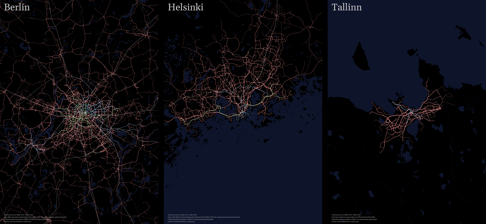
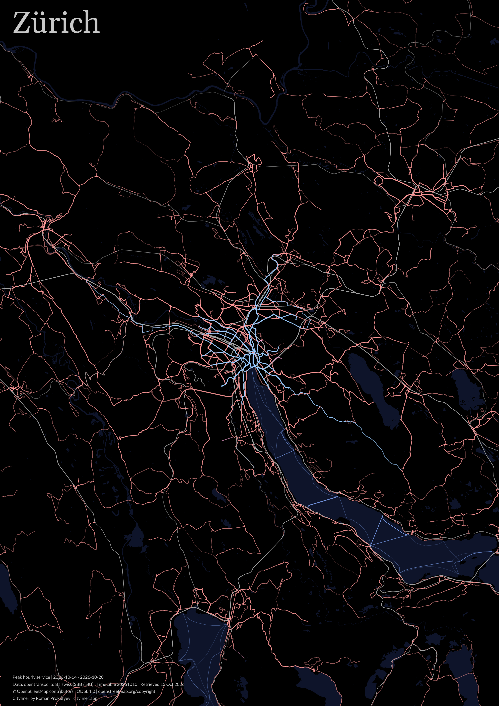
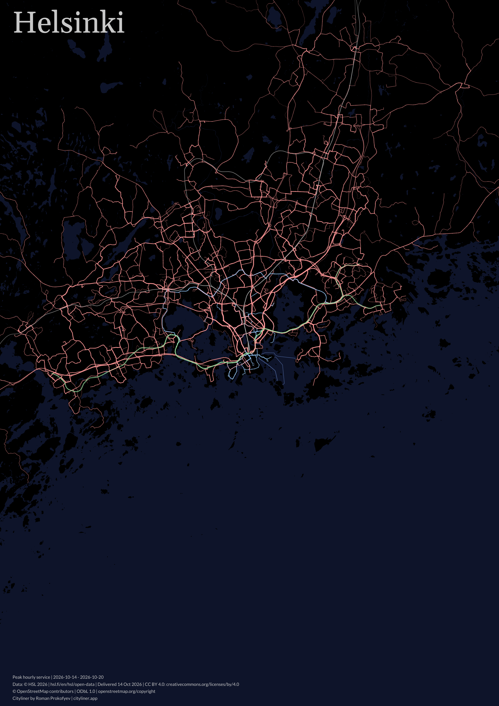
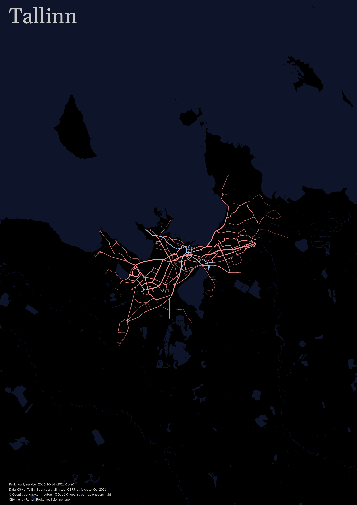
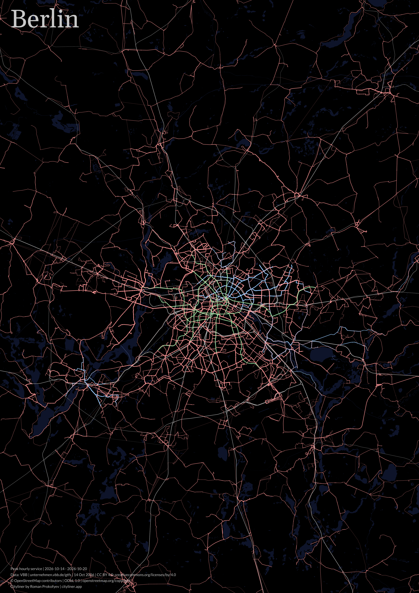

# Cityliner



Generate transport posters and an interactive day explorer from GTFS schedules.
[Try the website](https://cityliner.app/) or [request a city](https://github.com/dragoon/cityliner/issues/new?template=city_request.yml).

## Setup

Use Python 3.11:

```sh
python3.11 -m venv .venv
.venv/bin/pip install -r requirements.txt
```

Gelasio and Lato are bundled. No system fonts or local configuration are needed.
Keep downloaded GTFS feeds in ignored `gtfs/` and generated files in `processed/` or `posters/`.

## Posters

Provide a GTFS directory containing `routes.txt`, `trips.txt`, `stop_times.txt` and `shapes.txt`:

```sh
.venv/bin/python main.py --gtfs gtfs/helsinki --place-name helsinki \
  --center 60.1706017,24.9414482 --poster --color-scheme pastel
```

The PDF is written to `posters/helsinki-20.pdf`. `--max-dist` sets the vertical half-extent in km (default 20).
Use `--poster` for A0, or supply both `--width` and `--height`.

- Palettes: `pastel` (default), `default` (ivory), `inferno` (apricot), `earthy` (green), `cool` (lavender).
- `--water` and `--admin-borders` add map features. For sea polygons, download the [WGS84 water shapefile](https://osmdata.openstreetmap.de/data/water-polygons.html) into `oceans/`.
- `--credit` adds attribution; `--logos` selects SVGs in `assets/logos/CITY/` when you are entitled to use them.
- `--heading-font` or `CITYLINER_HEADING_FONT` optionally overrides Gelasio.
- [City presets](citylines/process_configs.py) support repeatable batch runs.

For date-aware intensity, use an exported [explorer bundle](docs/explore/README.md):

```sh
.venv/bin/python -m citylines.poster_bundle --bundle processed/explorer/CITY/BUNDLE_ID \
  --output posters/city.pdf --credit "Data provider and licence"
```

This uses the maximum scheduled departures in one hour during the bundle's week.
The legacy `main.py` renderer counts trip records without calendar filtering.

## Explorer

```sh
.venv/bin/python -m scripts.build_explorer_demo
.venv/bin/python -m http.server 8765 --bind 127.0.0.1 --directory processed/explorer-demo
```

Open <http://127.0.0.1:8765/>. The fictional demo is generated locally; no datasets are stored in the source tree.
See [export and hosting](docs/explore/README.md), [host integration](docs/explore/INTEGRATION.md) and [tests](docs/explore/TESTING.md).

## Examples

<p>




</p>

## Licences

Code: [GPLv3](LICENSE). Example images: [CC BY 4.0](https://creativecommons.org/licenses/by/4.0/).
Fonts, source data and logos retain their own terms; see [credits and marks](docs/POSTER-SOURCES.md).
Production branding, datasets, analytics and deployment are maintained separately.
Inspired by [Michael Mueller's GTFS visualisations](https://github.com/cmichi/gtfs-visualizations).
